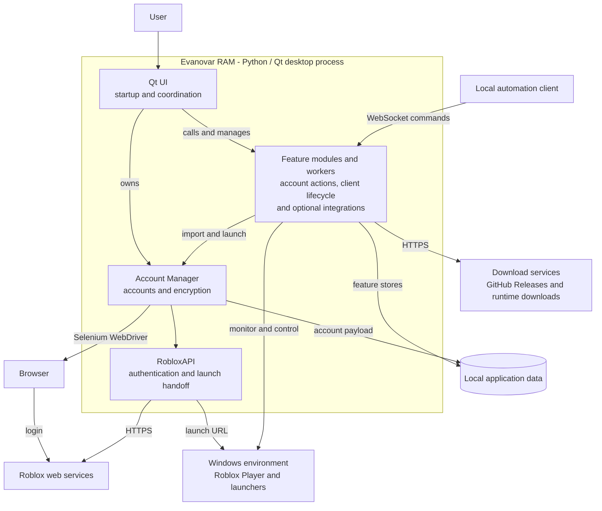

# Developer Architecture

[README](../README.md) · [Major workflows](workflows.md)

Evanovar RAM (Roblox Account Manager) is a Windows desktop application that keeps
Roblox accounts locally, authenticates launches as those accounts, and manages
the resulting Roblox clients. Its main architectural challenge is coordinating
account credentials, remote Roblox responses, and Windows processes without
blocking the interface or confusing one account's client with another.

Start here for the system's organization, then read [Major workflows](workflows.md)
for startup, account acquisition, client launch and recovery, and application
updates. Together these documents are intended to take about 10–15 minutes.

## System view

The application is a desktop monolith: the Qt UI, account manager, and feature
workers share one Python process. Browsers, Roblox Player, launchers, and temporary
helpers run outside it. Persistent state lives in local files; there is no remote
application backend or database.

This [C4-inspired component view](https://c4model.com/diagrams/component) shows the
main responsibilities inside the desktop process and the systems they use.
Component names group related existing code; they are not independently deployed
services. Arrows show requests or dependencies, with results returning to callers.

The diagram concentrates on account and client coordination. Other feature
modules also call Roblox services and write local files directly. The updater's
installation helper and the log-probe helper are described below.

## Technology stack

Dependency declarations live in [pyproject.toml](../pyproject.toml), the Python
version in [.python-version](../.python-version), and resolved versions in
[uv.lock](../uv.lock).

| Technology | Role |
| --- | --- |
| Python 3.15 | Application logic, threads, subprocesses, and file storage. |
| PySide6 / Qt | Widgets, dialogs, tray integration, timers, and signals. |
| Requests | Synchronous HTTP requests to Roblox and download services, generally from workers. |
| Selenium | Automated browser sessions for account login and signup; supports installed browsers and optional portable Chromium. |
| PyCryptodome | AES-GCM account encryption with PBKDF2-derived hardware or password keys. |
| psutil, pywin32, and standard-library ctypes | Process discovery, Windows handles, windows, input, and OS integration. |
| websockets / asyncio | Optional local command server, with its own event loop in a background thread. |
| uv / PyInstaller | Locked environments and a single Windows executable built from the same source entry point. |

## Code organization and responsibilities

The folder names describe broad responsibilities rather than strict layers.
`utils/ui.py` is the main coordinator as well as the widget implementation;
`classes/` contains shared account, encryption, API, and result types;
`features/` contains operations and long-running workers. Feature modules call
each other and the shared classes directly. There is no separate controller,
service container, or plugin framework.

| Component | Responsibility and starting points |
| --- | --- |
| Entry point and Qt UI | [main.py](../src/main.py) resolves startup options and installs diagnostics. [ui.py](../src/utils/ui.py) creates `QApplication`, unlocks account data, constructs `AccountManagerUIQt`, wires callbacks, and owns worker lifetimes. |
| Account Manager | [account_manager.py](../src/classes/account_manager.py) owns the username-keyed account dictionary, secure settings, browser sessions, account saves, and the shared launch gate. [encryption.py](../src/classes/encryption.py) supplies encryption and its configuration. |
| Account actions | [account_actions.py](../src/features/account_actions.py) adapts UI requests into background imports and launches, aggregates batch results, and also implements Anti-AFK and Multi Roblox. [browsers.py](../src/features/browsers.py) locates browsers; [account_creator.py](../src/features/account_creator.py) reuses the manager's browser acquisition path. |
| RobloxAPI | [roblox_api.py](../src/classes/roblox_api.py) provides account lookup, authentication tickets, presence and destination resolution, and launcher handoff. Specialized features such as [private_servers.py](../src/features/private_servers.py) and [game_selector.py](../src/features/game_selector.py) make additional Roblox requests themselves. |
| Client lifecycle | [launch_monitor.py](../src/features/launch_monitor.py) confirms Multi Roblox launches. [auto_rejoin.py](../src/features/auto_rejoin.py) monitors configured accounts and relaunches disconnected clients. [presence.py](../src/features/presence.py) supplies shared process discovery, window enumeration, and log evidence. |
| Window and settings integration | [window_renamer.py](../src/features/window_renamer.py), [headless_manager.py](../src/features/headless_manager.py), and [window_grid.py](../src/features/window_grid.py) map, rename, hide, and arrange client windows. [roblox_settings.py](../src/features/roblox_settings.py) maintains a local profile and applies it to Roblox's settings XML. |
| Local storage and presentation data | [settings_store.py](../src/features/settings_store.py) caches UI settings under a lock. [groups.py](../src/features/groups.py), [favorites.py](../src/features/favorites.py), and [avatars.py](../src/features/avatars.py) own their respective data. [account_backup.py](../src/features/account_backup.py) handles portable password-encrypted exports. |
| Optional commands and distribution | [websocket_server.py](../src/features/websocket_server.py) reuses the manager and Auto-Rejoin workers. [updater.py](../src/features/updater.py) checks releases and installs packaged updates; [chromium.py](../src/features/chromium.py) and [roblox_downloader.py](../src/features/roblox_downloader.py) install external runtimes. |

## Execution and state boundaries

**UI thread and workers.** Qt owns widgets on the main thread. Blocking browser,
network, and process work usually runs in Python threads. Workers report through
callbacks; the UI's `_Bridge` emits Qt signals to update widgets on the UI thread.
Timers schedule UI work and deferred startup tasks. The WebSocket server runs its
async event loop separately and offloads command execution to an executor.

**Persistence.** [app_paths.py](../src/utils/app_paths.py) separates bundled
resources from writable data. `AccountManagerData` defaults to the repository or
executable directory; `--data-dir` overrides `RAM_DATA_DIR` before modules that
cache file paths are imported. The account payload and secure settings share
`saved_accounts.json`; `encryption_config.json` selects hardware, password, or no
encryption. Other settings, Auto-Rejoin configurations, caches, and logs have
their own files and are not covered by account encryption.

The manager serializes account writes with a reentrant lock and publishes complete
files through temporary-file replacement. It maintains a compatible `.bak` copy
for startup recovery. Feature stores use their own locks and, where applicable,
[atomic_io.py](../src/utils/atomic_io.py). These are per-process coordination
mechanisms, not a transaction spanning all application files.

**Failures and diagnostics.** [OperationResult](../src/classes/operation_result.py)
carries success, error codes, user messages, technical details, and retryability
across many operations. Some older callbacks still return strings or booleans;
the UI normalizes them. Startup account failures use typed exceptions.
[diagnostics.py](../src/features/diagnostics.py) captures console output and
exceptions, redacts known secret patterns, and writes session and crash logs.

## External boundaries and constraints

- **Roblox services and clients:** cookies authenticate web requests; launch
  tickets are passed to Windows launchers. Remote presence is different from
  local process liveness. Rate limits and unavailable responses must remain
  distinct from confirmed authentication failures or disconnections.
- **Windows and Multi Roblox:** process control depends on Windows APIs and
  Roblox's native files and log formats. Multi Roblox uses singleton mutexes or
  Handle64, and protects shared native login files in both modes. Handle64 needs
  administrator rights and [Microsoft signature verification](../src/features/handle64_trust.py).
  Launch confirmation, Auto-Rejoin, and window renaming track creation times as
  well as PIDs to distinguish reused process IDs.
- **Helper processes:** [window_log_probe.py](../src/features/window_log_probe.py)
  isolates potentially hanging open-file inspection in a disposable subprocess.
  `main.py` dispatches this helper before importing Qt or installing diagnostics.
  The updater likewise needs a separate PowerShell process to replace a running
  executable after it exits.
- **Local automation:** WebSocket commands bind to `localhost` and start only
  when both the server and developer mode are enabled. Browser origins are
  explicitly allowlisted; password authentication and failed-attempt limits are
  configurable. This adapter operates on the same accounts and workers as the UI.
- **Downloads:** updates use GitHub Releases; portable Chromium uses Google's
  snapshot storage; Roblox downloads use Roblox deployment services and its CDN;
  Handle64 comes from Microsoft Sysinternals. Auto-Rejoin's connectivity probes
  are configurable and default to Google and Cloudflare.
- **Cleanup:** normal exit stops managed workers, restores hidden windows and
  quarantined installers, and releases settings-file protection owned by RAM.
  Hiding the window to the tray keeps the application and workers running.

## Build and verification entry points

The [README](../README.md#build-from-source) contains setup and build commands.
[scripts/build.py](../scripts/build.py) and
[packaging/EvanovarRAM.spec](../packaging/EvanovarRAM.spec) define packaging;
[utils/version.py](../src/utils/version.py) supplies the version. The build runs
an offscreen startup smoke check against temporary application data.

[scripts/run_tests.py](../scripts/run_tests.py) discovers unit, UI, and integration
suites under [tests](../tests), isolates application data, and selects Qt's
offscreen platform. [tests.yml](../.github/workflows/tests.yml) records the required
Windows lint and test checks. Follow the four [Major workflows](workflows.md) for
the relevant source and focused regression tests when changing behavior.
