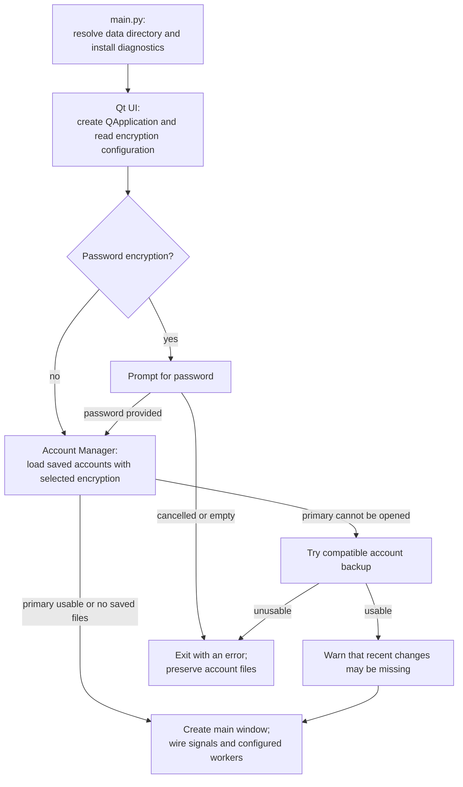
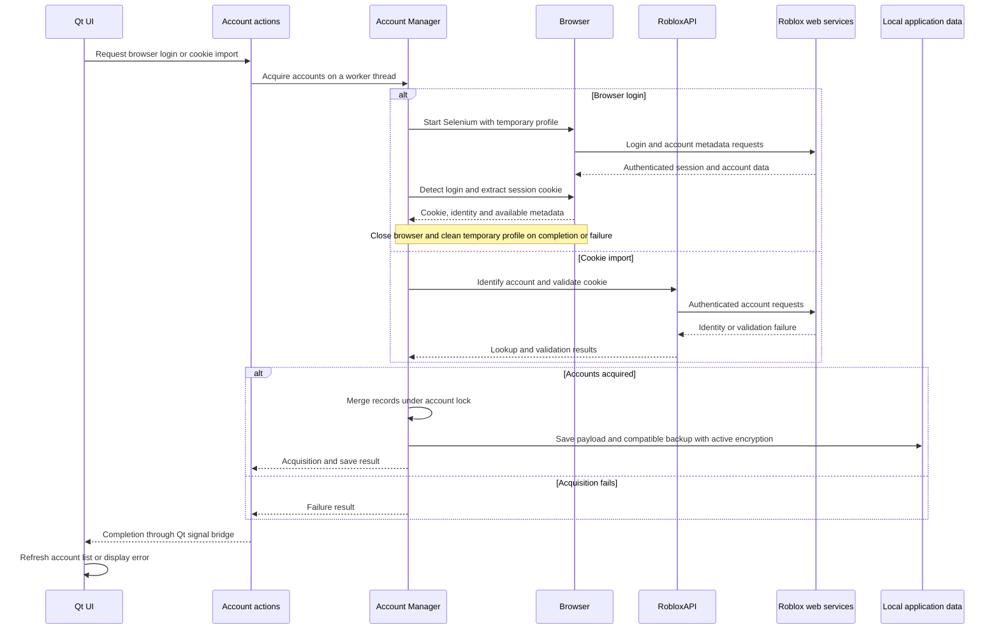
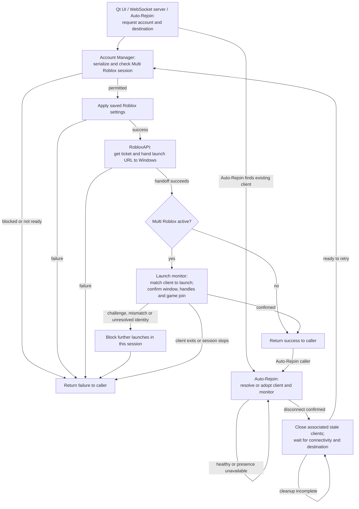
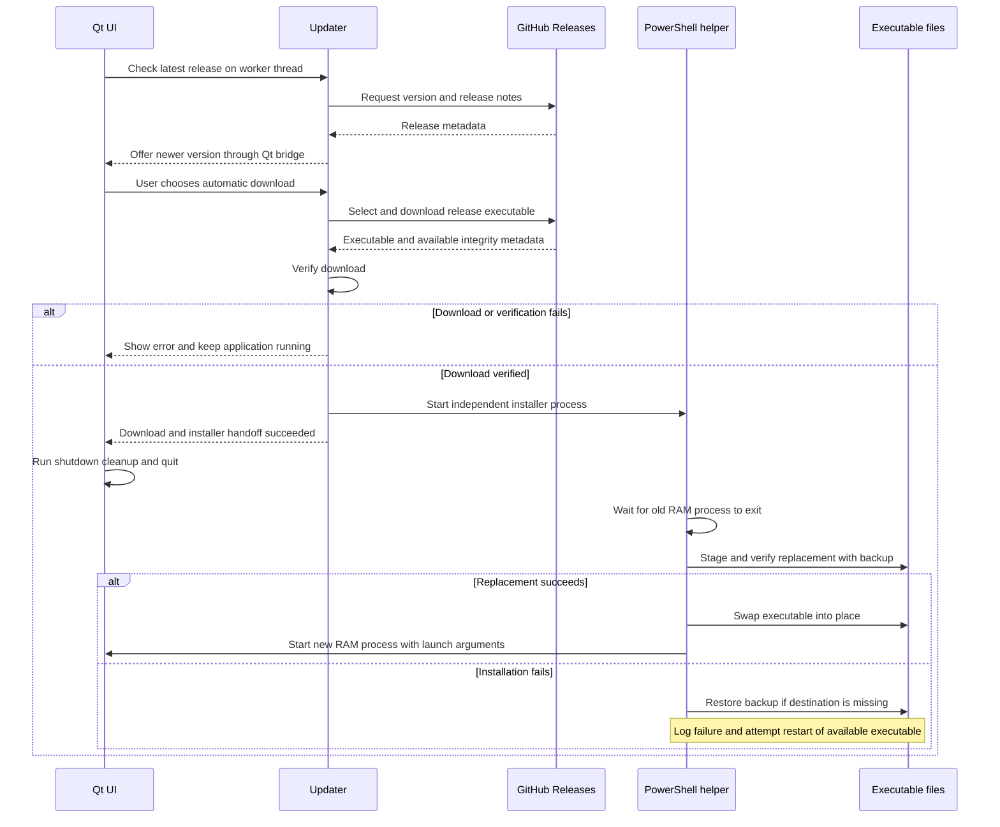

# Major Workflows

[Developer Architecture](architecture.md) · [README](../README.md)

These four workflows cover the main transitions between UI coordination, account
state, external services, and Windows processes. They were selected for the
components and failure boundaries they connect.

- [Startup and recovery](#1-startup-and-recovery)
- [Acquiring and saving accounts](#2-acquiring-and-saving-accounts)
- [Launching and recovering Roblox clients](#3-launching-and-recovering-roblox-clients)
- [Updating the packaged application](#4-updating-the-packaged-application)

## 1. Startup and recovery

**Purpose:** open the selected local profile safely before exposing accounts and
starting background features. This workflow establishes the application's data,
encryption, UI-thread, and worker-lifetime boundaries.

`main.py` applies the data-directory option before importing modules that cache
paths, installs diagnostics, and shows the splash screen. The Qt entry point
creates `QApplication` before any dialogs, then reads the encryption configuration.
Hardware mode derives its key locally; password mode prompts before constructing
the Account Manager. First-run encryption setup appears inside the main window.

The manager loads the primary account file or tries its compatible backup. If
neither can be read and, when encrypted, authenticated, startup reports a typed
account data, password, or hardware decryption error rather than continuing with
an empty account list. A usable backup allows startup with a recovery warning.

After loading, the UI receives the manager, connects its Qt signal bridge, and
starts or schedules features according to saved settings. Normal application
exit invokes UI cleanup; hiding to the tray continues the same process.

**Code:** [main.py](../src/main.py), [app_paths.py](../src/utils/app_paths.py),
[ui.py](../src/utils/ui.py) (Qt entry point and shutdown cleanup),
[account_manager.py](../src/classes/account_manager.py),
[encryption.py](../src/classes/encryption.py).
**Regression examples:** [account recovery UI](../tests/ui/test_account_recovery.py)
and [account saves and recovery](../tests/unit/test_account_save.py).

## 2. Acquiring and saving accounts

**Purpose:** turn a browser login or supplied cookie into a reusable local account
record. This connects the UI, background operations, browser automation, Roblox
identity lookup, and encrypted persistence.

Account actions resolves the configured browser and starts a worker. The manager
creates isolated Selenium profiles, waits for login, and extracts the session
cookie, identity, and available password/avatar metadata. Browser-context lookup
can fall back to RobloxAPI. Browser sessions and profiles are cleaned up as each
attempt finishes.

Raw-cookie import bypasses Selenium: the manager checks the cookie format, looks
up the account, and validates authentication through RobloxAPI. User/password
imports and account creation reuse browser acquisition, with different scripts
and batching around the same manager.

Successful records merge into the username-keyed dictionary; reimport preserves
an existing note when the incoming record has none. Multi-account acquisition
saves successful records after the batch. The account payload includes secure
settings and uses the active encryption mode. Atomic file replacement prevents a
failed write from truncating the published file; it is not a rollback of every
in-memory change.

Browser setup, navigation, login timeout, missing extraction data, cookie lookup,
authentication, and save failures have distinct paths. The separate startup
cookie validator preserves the distinction between repeated rejection and an
unknown result caused by rate limits or network failure.

**Code:** [account_actions.py](../src/features/account_actions.py),
[browsers.py](../src/features/browsers.py),
[account_manager.py](../src/classes/account_manager.py),
[roblox_api.py](../src/classes/roblox_api.py),
[encryption.py](../src/classes/encryption.py),
[cookie_validator.py](../src/features/cookie_validator.py).
**Regression examples:** [cookie reimport](../tests/unit/test_cookie_reimport.py)
and [account locking](../tests/unit/test_accounts_lock.py).

## 3. Launching and recovering Roblox clients

**Purpose:** launch the requested account and destination, then keep configured
sessions running without duplicating clients or mixing account identities. This
is the main collaboration between remote authentication and local process state.

**Shared launch path.** UI account actions resolve a destination and dispatch
single or staggered batch launches. WebSocket commands and Auto-Rejoin also call
the Account Manager. Its launch lock serializes all callers, including the
settings hook, launcher handoff, and any Multi Roblox confirmation. Failed
settings application stops the launch. RobloxAPI obtains a CSRF-backed
authentication ticket and builds a launch URL for the Windows protocol handler
or selected executable. It supplies a unique browser tracker ID to connect that
request with the new client.

**Multi Roblox confirmation.** Enabling either mode requires existing clients to
be closed and shared native login files to be protected. Default mode creates
singleton mutexes; Handle64 mode uses a verified helper to close client singleton
handles and waits for readiness before another launch. Protection preserves file
contents; it does not prove the identity used by a Roblox verification challenge.

While Multi Roblox is active, the launch monitor matches the exact tracker to a
new process and waits for a stable client window and handle readiness. Game
launches also require the matching startup log to report the saved user ID;
Home launches only require client readiness. Challenges, account mismatches, and
unresolved launch identity block further launches in that session across every
caller. Ordinary client exit or session shutdown returns a failure without that
same persistent block. Outside Multi Roblox, the manager reports launcher
handoff success without this confirmation stage.

**Recovery loop.** Each started Auto-Rejoin worker adopts a matching existing
client or launches and resolves a new one to the account's user ID. It tracks PID
and creation time, then checks liveness and optional Roblox presence. Two
consecutive disconnection checks trigger recovery; unavailable presence is a
temporary unknown state. Before relaunching, it closes associated stale clients,
waits for connectivity and a usable destination, and rechecks for an existing
client. Cleanup failure delays relaunch. Failed launches retry up to the configured
limit through the same manager gate, so a blocked Multi Roblox session cannot be
bypassed by Auto-Rejoin.

**Code:** [account_actions.py](../src/features/account_actions.py),
[account_manager.py](../src/classes/account_manager.py),
[roblox_api.py](../src/classes/roblox_api.py),
[launch_monitor.py](../src/features/launch_monitor.py),
[auto_rejoin.py](../src/features/auto_rejoin.py),
[presence.py](../src/features/presence.py),
[roblox_settings.py](../src/features/roblox_settings.py),
[websocket_server.py](../src/features/websocket_server.py).
**Regression examples:** [launch confirmation](../tests/unit/test_launch_monitor.py),
[native storage protection](../tests/unit/test_multi_roblox_cookies.py), and
[Auto-Rejoin](../tests/unit/test_auto_rejoin.py).

## 4. Updating the packaged application

**Purpose:** move from one executable version to another while crossing the
running-process boundary safely. This explains why updates use a helper rather
than replacing RAM's executable inside the UI process.

Startup checks respect the user's update setting and skipped version; a manual
check can still offer a skipped release. Release notes and progress return through
Qt signals. Automatic installation is available only in a frozen build; source
runs use manual download.

The updater selects the release executable, requires a GitHub HTTPS asset URL,
and downloads to a temporary directory. It checks that the file is nonempty,
has a Windows executable header, and matches the size and SHA-256 digest when
provided. Verification failure leaves the current process running.

After verification, an independent PowerShell helper receives the current PID,
target executable, and launch arguments. The UI reports this handoff, performs
normal cleanup, and exits. The helper waits for exit, stages the download,
verifies the staged copy, backs up the current executable, replaces it, and
starts a new RAM process. Replacement failures can restore the backup when the
destination is missing; other failures are logged and the available executable
is restarted if possible. Successful process creation is the helper's completion
check; it does not test the new application's runtime health.

**Code:** [ui.py](../src/utils/ui.py) (update dialog and quit path),
[updater.py](../src/features/updater.py),
[version.py](../src/utils/version.py).
**Regression examples:** [download verification](../tests/unit/test_updater_verification.py),
[update UI](../tests/ui/test_update_flow.py), and
[installer integration](../tests/integration/test_updater_install.py).
